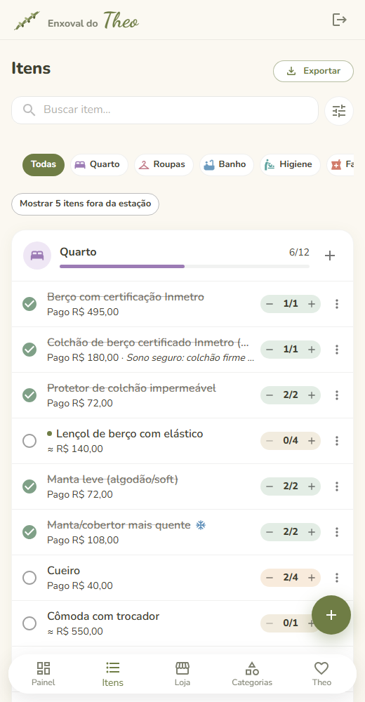

# Enxoval

Aplicativo web para casais planejarem e acompanharem o enxoval do bebê: o que precisa, o que já foi comprado ou
ganhado, quanto custou e quanto falta.

**Site:** https://baby-layette-app.vercel.app — crie sua conta, ou clique em "Só quero conhecer: ver a demonstração"
(os dados da demonstração ficam só no seu navegador).

<p align="center">
  
  
  
</p>

## Funcionalidades

- **Conta para cada pessoa, enxoval do casal:** cada um entra com o próprio e-mail e senha; um convite (link ou
  código) coloca a outra pessoa no mesmo enxoval. Funciona em vários aparelhos ao mesmo tempo.
- **Lista pronta para começar:** cerca de 90 itens em 9 categorias (Quarto, Roupas, Banho, Higiene, Farmácia,
  Amamentação, Passeio, Mala da Maternidade e Acessórios), com quantidades, tamanhos e preços estimados, tudo editável.
- **Painel:** progresso geral e por categoria, semanas de gestação, contagem até o parto, valor estimado, gasto e saldo
  do orçamento.
- **Clima do nascimento:** a partir da cidade e da data prevista, o app usa a média histórica de temperatura para
  indicar se vão precisar de itens de frio ou de calor.
- **Modo loja:** checklist só com o que falta comprar, para usar no celular durante as compras.
- **Registro de compras:** quantidade, valor pago e se o item foi comprado ou ganhado de presente.
- **Fotos dos itens:** tire pela câmera do celular ou escolha da galeria.
- **Exportação:** lista de compras em PDF ou Excel.
- **8 temas e modo escuro:** temas para menina, menino e neutro, escolhidos nas boas-vindas.
- **App no celular (PWA):** instalável no Android e no iPhone.

## Tecnologias

- **Front-end:** React 19, TypeScript, Vite, Material UI, TanStack Query, React Hook Form
- **Back-end:** [Supabase](https://supabase.com) (Auth, Postgres com Row Level Security, Storage) — sem servidor próprio
- **Exportação:** jsPDF e ExcelJS, no navegador
- **Testes:** Vitest e Testing Library

A versão anterior, com API própria em .NET, está guardada em [legado/](legado/README.md).

## Como executar

Pré-requisito: [Node.js](https://nodejs.org/) 24 ou mais recente.

```bash
git clone https://github.com/daniel-ssoares/baby-layette-app.git
cd baby-layette-app
npm --prefix src/web install
npm --prefix src/web run dev        # http://localhost:5173
```

O front usa o projeto Supabase configurado em `src/web/.env`. Para usar outro projeto, siga
[supabase/LEIAME.md](supabase/LEIAME.md) (rodar os scripts SQL e copiar a URL e a chave publicável).

Sem configurar nada, o botão **"Só quero conhecer: ver a demonstração"** funciona com dados fictícios guardados no
navegador (conta `demo@enxoval.local` / `demo1234`).

### Usar no celular

Na mesma rede Wi-Fi: `npm --prefix src/web run dev:celular` e acesse `http://<ip-do-computador>:5173`.

O site publicado é um PWA: no Android aparece o botão **Instalar**; no iPhone, use Compartilhar → **Adicionar à Tela
de Início**. Ele abre em tela cheia e funciona mesmo com internet ruim.

## Testes

```bash
npm --prefix src/web test           # Vitest
npm --prefix src/web run build      # checagem de tipos + build
```

## Estrutura do projeto

```
src/web/            Front-end React (app inteiro: telas, regras, acesso ao Supabase)
supabase/           Esquema do banco, regras de acesso (RLS) e lista-padrão, em SQL
docs/               Requisitos e lista-padrão do enxoval
legado/             API .NET anterior (guardada, não usada)
```
